# EIGHT PAGES

A dark-forest survival-horror game in the spirit of **Slender: The Eight Pages**,
built with **Godot 4.7** (GDScript, GL Compatibility renderer). Collect eight
pages pinned to landmarks in a pitch-black wood while a very tall figure watches
from the tree line. Every texture, sound and mesh in this project is generated
from code — there are no third-party assets.

The forest is **photoreal-leaning, not stylised**: the trees are bare dead
trunks and snags (no leaves, no needle cards) built from tapered, bark-UV-mapped
meshes, and the ground is a procedural PBR material — albedo, normal and
roughness maps generated from layered value noise, scattered needle litter,
twigs and pebbles, moss settling into the hollows. Nothing is painted by hand.

**It is genuinely dark.** Ambient light is a cold 0.42 with the moon at 0.24, so
the flashlight is the only real light source: a 30° cone that carves a pool of
dirt and bark out of black. The far distance dissolves into fog rather than
fading into grey.

### The boundary, and what lies past it

The playable wood is a 122 m square, and the square is **fenced**. The boundary is
built the way a real chain-link fence is built: 3 m wire-mesh bays between
galvanised posts, a top rail, bottom tension wire, and a two-leaf vehicle gate at
the east side that hangs open. The mesh is a genuine alpha-scissor diamond weave,
not a painted-on band, and every post, bay and gate leaf carries its own collider
(a ring of 325 shapes, verified arithmetically in the test suite rather than by
watching a character walk into it).

Past the gate there is **no edge to fall off**. An endless, procedurally streamed
forest continues in 32 m chunks around the player, and a dirt road leaves through
the gate and wanders off to the horizon, so an escaped player always has somewhere
to walk. A 4 km collision slab sits under all of it.

### Pages you can touch

Each page is a small **verlet cloth sheet** — 7×9 vertices pinned along its top
edge, integrated at a fixed 60 Hz, three constraint passes, shear links so it
cannot fold into a fan of triangles, and smoothed per-vertex normals computed from
the live geometry. It sags under its own weight, stirs in the draft, and cannot be
pushed through the wall behind it.

Every page is **nailed to a real surface**: the face of the broken wall, the inside
of the tunnel, the silo shell, the truck's side panel, the shed's back wall, a
standing stone, the back of the ruined bathroom, and a scrap board nailed across
the watchtower's legs. Each landmark reports a surface point and an outward normal,
so a page is never left floating in a clearing.

They carry **no light of their own** — no lamp, no emission. Measured against the
wall beside it, a page reads 0.81× as bright under the torch and 0.86× in the
camera's IR mode: it is lit, not lit-up. And the **note is on the page**: the eight
messages are baked into `assets/textures/note_N.png` by `tools/gen_notes.py` and
used as the sheet's albedo, so what you read in the world is the message you get.

### Concrete that holds up close

Concrete and stone use a **world-space triplanar** projection at 1.2 m per texture
repeat: 2048² maps give ~1700 px/m on every face regardless of whether that face
belongs to a 1 m pillar or a 20 m wall. Before that, box-mesh UVs gave 100–3500
px/m on the same wall with up to 46:1 stretch. The maps themselves are isotropic
layered noise with Poisson-scattered aggregate, pits, bubbles, chips and hairline
cracks, mipmapped and anisotropic-filtered.

**You are watching it through a camcorder.** Every frame goes through one
full-screen pass (`shaders/camcorder.gdshader`, scene `scenes/Camcorder.tscn`)
that turns the renderer into the finder of a cheap night-shift video camera:
barrel warp inside the lens, radial chromatic aberration, a rolling-shutter band
that drags colour with it, tape tears and signal-loss blocks, scanlines, a grade
that lifts the night instead of crushing it, and — with the torch switched to its
second mode — a real IR night-vision tube. The camera itself is not bolted to the
player's head: it hangs off `RigidBody3D` "Handle", so it lags, leans and
shudders like something being carried.

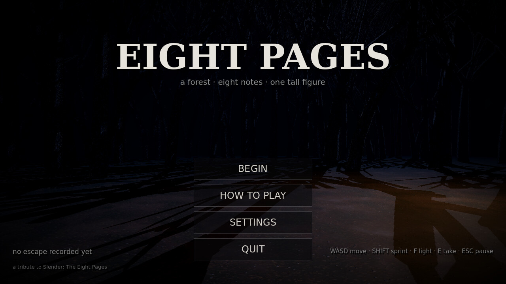
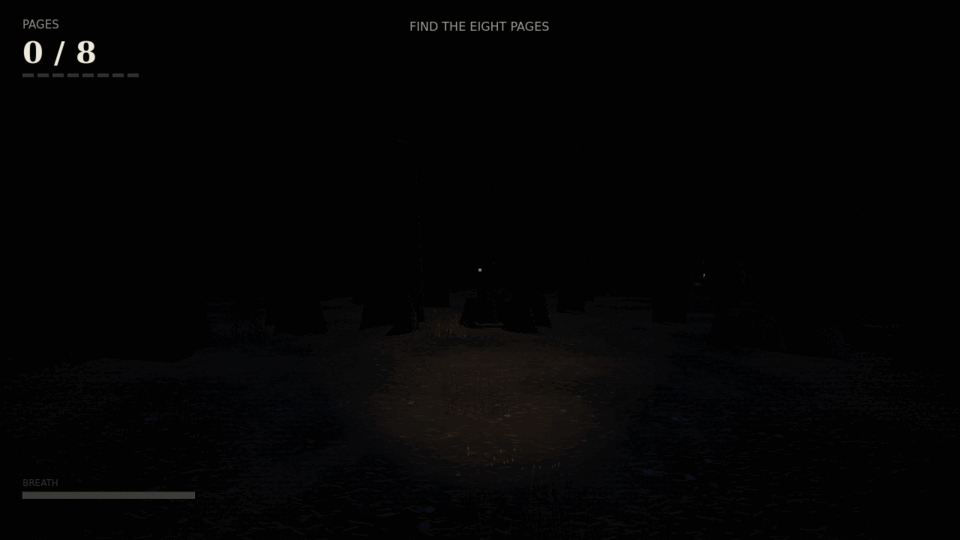

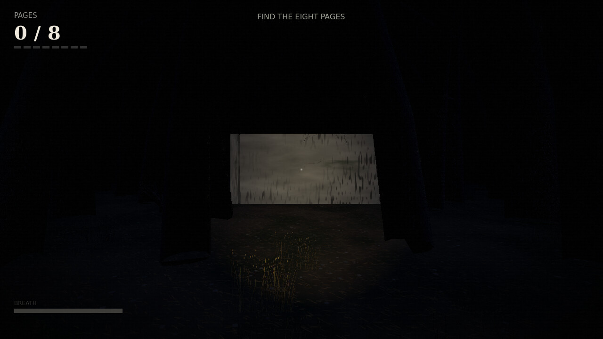
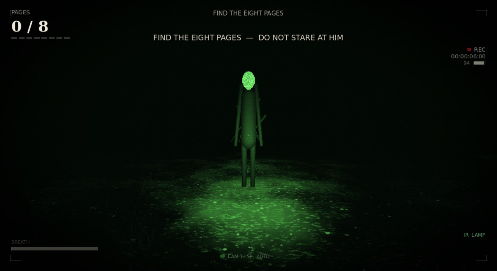

---

## Running it

### 1. From source (Godot 4.7+)

```bash
./eight_pages/run.sh                     # runs the game with the bundled Godot
# or with your own install:
godot --path eight_pages res://scenes/Title.tscn
godot -e --path eight_pages              # opens the editor
```

`run.sh` uses `$GODOT` if set, otherwise the Godot 4.7 binary in `../tools/`,
otherwise whatever `godot` is on your PATH.

### 2. Pre-built binaries (`build/`)

| Platform | File | Notes |
|---|---|---|
| **Web / mobile browsers** | `build/web/index.html` | pre-built; serve over HTTP (see below) |
| **Android** | `build/android/eight_pages.apk` | signed release APK v1.5.0 (arm64-v8a), 45 MB |
| **Linux** | build it yourself (preset included) | `--export-release "Linux" build/linux/EightPages.x86_64` |

Build them yourself:

```bash
godot --headless --path eight_pages --export-release "Web"     build/web/index.html
godot --headless --path eight_pages --export-release "Android" build/android/eight_pages.apk
godot --headless --path eight_pages --export-release "Linux"   build/linux/EightPages.x86_64
```

The shipped APK is arm64-v8a only to keep it small — flip
`architectures/armeabi-v7a` / `x86_64` back on in `export_presets.cfg` for wider
device support. The web export targets WebGL 2 via the GL Compatibility
renderer and needs no cross-origin isolation headers.

Serve the web build locally (the browser needs HTTP, not `file://`):

```bash
cd eight_pages/build/web && python3 -m http.server 8080
# then open http://localhost:8080
```

For phones on the same network use your machine's LAN IP, and on iOS/Android
add the page to the home screen for a full-screen, no-browser-chrome experience.

---

## Controls

| Action | Keyboard / mouse | Touch |
|---|---|---|
| Move | `W A S D` / arrows | floating stick — drag anywhere on the left half |
| Look | mouse | drag anywhere on the right half |
| Sprint | `Shift` (drains breath) | hold **RUN** |
| Flashlight / IR lamp | `F` — swaps the warm spot for the camcorder's IR lamp | **LIGHT** button |
| Take page | `E` (or simply walk into it) | **TAKE** button (auto-pickup also works) |
| Pause | `Esc` | **II** in the top-right corner |
| Dismiss a note | any of the above keys | it fades on its own |

Touch mode is detected automatically on mobile, Android/iOS web builds and any
device reporting a touchscreen. You can force it from **Settings → Force touch
controls**, or toggle it live in the pause menu.

**Keyboard and mouse are always live.** Touch mode adds the on-screen stick, it
never disables `WASD`, `Shift`, `E`, `F`, `Esc` or mouse look — a phone with a
mouse, a tablet with a trackpad or a desktop where touch auto-detection fired all
get the same controls.

The pointer follows one rule: **a free cursor never turns the camera.** In touch
mode the cursor belongs to the stick and the menus, so look is *drag*-look — hold
the left button and move. A real click on the world captures the pointer and
gives you full mouse look (this is also how the web build gets pointer-lock back
after an alt-tab, since the browser only grants it on a gesture). A finger never
triggers that capture: its emulated mouse click is ignored, and its emulated
mouse motion never looks twice — the touch overlay owns the finger's look.

The camcorder is not forced on anyone: **CAMCORDER FX** in the pause menu turns
the lens/tape pass (and the on-screen REC/timecode furniture) off, and
**HANDHELD CAMERA** swaps the simulated rig for a cheaper procedural spring.

---

## The rules of the forest

* Eight pages are pinned to eight landmarks: **concrete walls, a tunnel, a silo,
  a truck, a shed, a ring of stones, a ruined bathroom and a watchtower**.
* **Pumpkins and dead bushes.** Patches of ribbed, dirt-streaked pumpkins grow
  in the clearings and around every landmark (some knocked over), and dense
  leafless bushes — branched twig clumps, not painted billboards — fill the
  undergrowth, thickest toward the tree line.
* **Every run is laid out from a fresh seed.** The landmark order, their
  positions and rotations, their individual variations (a shed with or without
  a lean-to, a truck on its wheels or flipped, one wall or a broken run of
  three…), the page spots, the forest density, the undergrowth and the ground
  debris are all randomised. Landmarks keep a circular 24–30 m spacing and never
  spawn within 14 m of the tree-line clearing you start in, and every page spot
  is validated as reachable before it is used.
* He appears at the edge of the trees. **While you look at him he cannot move**
  — every time you look away he is closer.
* **Stare too long and he charges.** Sprint will not save you for long.
* Static is his voice. It rises with his presence and with the number of pages
  in your pocket; heartbeat speed is distance.
* The flashlight dies when he is close (or when you point it at him).
* Eight pages collected = you escape. Anything less = *he found you*.

Difficulty ramps with every page: shorter apparition cooldowns, faster approach,
quicker chases.

---

## Project layout

```
eight_pages/
├── project.godot            # GL Compatibility, canvas_items stretch, input map
├── export_presets.cfg       # Web / Android / Linux presets
├── scenes/
│   ├── Title.tscn           # menu, settings, how-to-play
│   ├── World.tscn           # the run: map builder + player + slender + HUD
│   ├── Player.tscn          # CharacterBody3D, head anchor, handheld rig, torch
│   └── Camcorder.tscn       # the video-camera finder: post pass + chrome
├── scripts/
│   ├── game.gd              # autoload: state, input routing, quality/touch detection
│   ├── settings.gd          # autoload: persisted settings (user://settings.cfg)
│   ├── sfx.gd               # autoload: looping ambience + one-shot pool
│   ├── title.gd             # title screen UI
│   ├── world.gd             # run orchestration, pages, static feedback, endings
│   ├── map_builder.gd       # procedural forest, eight landmarks, chain-link boundary
│   ├── endless_terrain.gd   # streamed forest + road outside the fence
│   ├── page_cloth.gd        # verlet cloth sheet for each collectible page
│   ├── road_ribbon.gd       # crowned ribbon mesh builder for the road
│   ├── player.gd            # FPS controller (mouse + touch), stamina, head bob
│   ├── camera_handle.gd     # the RigidBody3D "handle" the camera hangs off
│   ├── camcorder.gd         # drives the post pass + REC/timecode/battery chrome
│   ├── slender.gd           # the tall one: apparitions, gaze logic, chase, kill
│   ├── hud.gd               # all gameplay UI in code (no .tscn needed)
│   ├── touch_controls.gd    # virtual stick / swipe look / buttons
│   ├── autotest.gd          # scripted runs + screenshot tours
│   ├── selftest.gd          # 47 world assertions
│   ├── camera_test.gd       # 30 assertions on the handheld camera rig
│   ├── controls_test.gd     # 20 assertions on the control paths
│   └── flowtest.gd          # Title → BEGIN → World → pause → pickup
├── shaders/
│   ├── camcorder.gdshader   # the whole video-camera post chain, one pass
│   ├── static.gdshader      # legacy film-grain overlay (A/B path)
│   └── vignette.gdshader
├── assets/
│   ├── audio/*.wav          # synthesised wind, drone, static, heartbeat, steps…
│   ├── textures/*.png       # PBR ground/bark/stone/grass/litter, paper, noise
│   ├── models/*.res         # baked tree / snag / log / stump / shrub / pumpkin / bush meshes
│   └── fonts/               # DejaVu Sans + Serif (licence: Bitstream Vera / public)
├── run.sh                   # launcher (bundled Godot or your own)
├── VERSION.txt
├── tools/
│   ├── gen_assets.py        # regenerates base textures, sounds, title plate
│   ├── gen_textures_real.py # PBR ground/bark/stone/grass/litter maps
│   ├── gen_trees.gd         # bakes the bare-tree meshes into assets/models
│   ├── gen_title_bg.gd      # renders the menu backdrop from the tree meshes
│   ├── gen_concrete.py      # 2048² concrete albedo/normal/rough, isotropic
│   ├── gen_notes.py         # bakes the eight page notes into note_N.png
│   ├── setup_toolchain.sh   # JDK 21 + Android SDK + keystores + templates
│   ├── run_sway.sh          # headless sway compositor + Godot runner
│   ├── capture_screens.sh   # full screenshot capture inside sway
│   ├── web_capture.py       # Playwright capture of the web build (desktop + phone)
│   └── test_all.sh          # the whole verification suite
└── screenshots/             # sway-rendered captures used by this README
```

---

## Testing

Everything below runs headless — no physical display required.

```bash
tools/test_all.sh                  # 47 world + 30 rig + 20 control checks + scripted runs in sway
tools/test_all.sh --with-web --with-android
```

What the suite covers (`tools/test_all.sh`, logs in `/tmp/eight_test_out`):

| Check | What it proves |
|---|---|
| `controls` | the control paths, measured: mouse yaw/pitch scale and sign (with `invert_y` and sensitivity applied exactly once), `WASD` walks ~1.15 m in 1.2 s **and still does with touch mode on**, a finger's drag looks once (a double-application would be 2×), moving the cursor in touch mode or an absolute event turns the camera **not at all**, drag-look in touch mode does, the stick never moves the view, pitch clamps, `F` toggles the lamp, pause stops movement and resume restores it, the stick is not latched across a pause, and the overlay is silent while paused or frozen |
| `camtest` | the camera really is carried by a rigid body: idle settle, **turning lags then catches up without overshoot**, teleports and 180° cuts resync, a stalled tick is clamped, walking shakes the rig within its tether, impacts kick and recover, never NaN or flyaway under sprint + shake + impact, procedural fallback behaves the same, switching back works |
| `selftest` | **every tree triangle is wound to match its vertex normals** and every face survives a "step out along the normal and shoot back" test (nothing is inside-out), **the chain-link fence is a closed ring of 325 colliders with an open 5 m gate**, pages are live cloth with no light of their own and normals facing forward, endless terrain chunks + road exist and a second floor slab catches anything that leaves the fence, 8 distinct pages in bounds, layouts differ between seeds, landmarks spread ≥18 m, every page spot walkable, win bookkeeping, walking/sprinting, stamina, mouse & touch look (**both alive in touch mode**), wall + floor collision, pickup → HUD → note → Slender woken, gaze detection, chase → capture → death screen |
| `win path` | scripted collection of all 8 pages reaches the win screen |
| `death path` | Slender catches the player, jumpscare, death screen shown |
| `flow` | **Title → BEGIN → World → pause → resume → movement → first pickup**, inside sway, plus *picking up a page while paused is impossible* |
| `desktop shots` | 20 sway-rendered screenshots of every landmark, Slender, HUD, note overlay |
| `mobile shots` | same tour at phone resolution with touch UI; asserts the injected virtual-stick drag produced the expected move vector |
| `endings` | pause menu, jumpscare and death screen captures |
| `win screen` | win sequence capture |

The game itself also ships with the harness used by those tests:

```bash
# inside sway (real Wayland session):
tools/run_sway.sh res://scenes/World.tscn -- --autotest=selftest
tools/run_sway.sh res://scenes/World.tscn -- --autotest=camtest --quality=2
tools/run_sway.sh res://scenes/World.tscn -- --autotest=controls
tools/run_sway.sh res://scenes/World.tscn -- --autotest=perf --quality=1
tools/run_sway.sh res://scenes/World.tscn -- --autotest=shots --quality=1
tools/run_sway.sh res://scenes/World.tscn -- --autotest=shots --quality=0 --touch
tools/run_sway.sh res://scenes/Title.tscn -- --flow
```

### Code audit

`audit/` keeps the prompts and transcripts of the static-audit passes run with
[opencode](https://opencode.ai), including two deepseek agents run in parallel
during the 1.5.0 correction cycle (`audit/agents/CONCRETE_PBR.md` measured texel
density surface by surface; `audit/agents/CLOTH_TERRAIN.md` found eleven real
bugs in the cloth solver and the terrain streamer, all fixed). The `glm-5.3-flash` pass over the nine gameplay
scripts produced twelve findings; all twelve were applied and are covered by the
suite (boundary-fence orientation, Slender facing/pathing, paused pickups,
win-time bookkeeping, stamina, jumpscare framing, tween leaks, audio-loop tweens).

### How sway is used

`tools/run_sway.sh` starts `sway` on the **headless** backend with the **pixman**
software renderer (the sandbox has no `/dev/dri`), waits for the Wayland socket,
then launches Godot with `--display-driver wayland --rendering-driver opengl3`.
Screenshots come from Godot's own viewport texture; `grim` is used for whole-screen
captures such as the title. The same script is what the mobile-resolution runs use,
with `--touch` forcing the mobile UI.

### Quality tiers

`--quality=0|1|2` (auto-detected: software GL → 0, Intel/Mali/Adreno → 1,
everything else → 2) tunes fog, shadow casting, glow, tree count and particle-free
lighting so the game stays playable on phones and on `llvmpipe`.

---

## The camcorder

**One pass, one screen fetch.** `scenes/Camcorder.tscn` is instantiated at the
bottom of the HUD's canvas stack: the tape and the lens are baked over the 3D
frame before the game's own typography is composited, and menus, notes and fades
still cover the whole thing. The shader samples the screen texture once at
quality 0 and three times (red/green/blue) at quality 1–2 for the aberration;
everything else is arithmetic on those taps plus two small noise fetches. No
passes, no loops. In the software-rendered sway harness the whole chain costs
about **10% of a 330 ms frame** (measured with `--autotest=perf`), i.e. it is
noise next to the forest itself.

Params are lerped on the CPU and handed to the shader as floats, so the look
reacts smoothly to danger: `world.gd` computes one `dread` value from the same
static/slender signal the audio uses and calls `hud.set_dread()`.

| Stage | What it does |
|---|---|
| lens warp + zoom | barrel distortion inside the lens circle, aspect-corrected; a slow "hunting" digital crop as danger rises |
| chromatic aberration | radial R/B split, scaled by dread and by the IR gain |
| rolling band | soft bright band scrolling up the frame, dragging a little colour |
| tear / dropout | displaced horizontal slices and signal-loss blocks; the jumpscare tears the picture off its own scanlines |
| grain + dirt | sensor noise weighted by signal (never louder than the picture), low-frequency lens smudges |
| grade | gamma lift + shoulder instead of a 0.5-pivot contrast (which would blacken a night forest), cold shadows / warm highlights |
| night vision | with the torch in its IR mode: 5-tap softening, steep tube transfer, monochrome green |
| chrome | corner brackets, blinking REC, 25 fps timecode, tape counter (bottom centre, clear of the touch stick), battery, IR lamp flag |

**The camera rig.** `scenes/Player.tscn` puts the `Camera3D` under
`Head/Handle/CameraMount`, where `Handle` is a `RigidBody3D`. `Handle` is
tethered to an `AnimatableBody3D` at eye height by a `Generic6DOFJoint3D`
(`linear_*` limits and springs: 11.5 cm of travel, soft limit, restitution
0.05). Each physics tick the spring-damper law of that tether is fed to the body
as a velocity servo with anchor-velocity feed-forward, so:

* walking produces no steady lag but a real transient — the camera leans back as
  you start moving and overshoots a step;
* footsteps are impulses, so the view drops and rolls with each stride;
* running into a tree is a real impulse: the rig is thrown and settles back;
* aiming drives the *head*, and a critically damped PD controller turns the body
  towards it, so a fast flick trails and settles instead of snapping;
* teleports (spawn, `look_at_point()`, cutscenes) are detected from the per-tick
  delta and resync instantly; the rig also self-heals if it ever escapes its
  tether or the solver returns a non-finite transform.

`CameraMount` is interpolated between physics ticks with
`Engine.get_physics_interpolation_fraction()`, so the picture is smooth at any
framerate. At quality 0 (software renderers, weak phones) or with
**HANDHELD CAMERA: OFF** the same public API is served by a procedural
exponential spring instead of a body.

> Why the servo: in Godot 4.7 **neither GodotPhysics3D nor Jolt moves a jointed
> body when its partner is a kinematic anchor** — the joint's frames are frozen
> at setup. A constant-force probe showed the constraint applying no force at all
> while the anchor walked away (`.git` history: commit message on the rig). So
> `camera_handle.gd` reads the travel and spring constants off the joint, then
> hands the equivalent law to the simulated body itself. Same physical model,
> predictable trail, real mass and real impulse response.

---

## Regenerating assets

```bash
python3 tools/gen_assets.py       # base textures, audio, paper — run this FIRST
python3 tools/gen_textures_real.py   # PBR ground / bark / stone / grass / litter
godot --headless --path . --script tools/gen_trees.gd     # bare-tree meshes
godot --path . --script tools/gen_title_bg.gd             # menu backdrop (needs GL)
godot --headless --path . --import                        # refresh .import files
```

`gen_assets.py` overwrites the old flat textures, so always regenerate in that
order — `gen_textures_real.py` must come last or its PBR maps are replaced by the
painted ones.

* **Textures** — `gen_textures_real.py` builds tiling **PBR sets** (albedo,
  normal, roughness) for soil, bark and concrete from layered value noise plus
  Poisson-scattered needles, twigs and pebbles; `gen_assets.py` supplies the aged
  paper, the note sheet, the UI noise and the audio. The menu backdrop is a real
  render of the bare-tree meshes (`gen_title_bg.gd`), not a painting.
* **Meshes** — `gen_trees.gd` bakes six trunks, two snags, a fallen log, a stump
  and a dead shrub as `.res` meshes with world-space bark UVs and visible root
  flares; they are drawn with `MultiMesh` and per-instance tints.
* **Audio** — all WAVs are synthesised: wind and drone beds (cross-faded into
  seamless loops at runtime), heartbeat, breathing, four footstep variants,
  page rustle, apparition swell, jumpscare, win sting and UI click.

## Mobile notes

* `canvas_items` stretch with `expand` aspect; the design resolution flips to a
  portrait-friendly 720×1280 when the window is taller than wide.
* The camera switches to `KEEP_WIDTH` in portrait so you don't get tunnel vision.
* Touch UI: floating stick (left), swipe-look (right), RUN / LIGHT / TAKE buttons
  with generous 45 px+ targets, plus a dedicated pause button.
* Notes never block play — they fade, and any input dismisses them.
* Android export uses the OpenGL Compatibility renderer with ETC2/ASTC textures;
  the shipped APK is arm64-v8a (97% of devices), with arm32/x86_64 one flag away.

## Screenshots

All of these were rendered by the game itself inside headless sway:

| | |
|---|---|
|  |  |
| 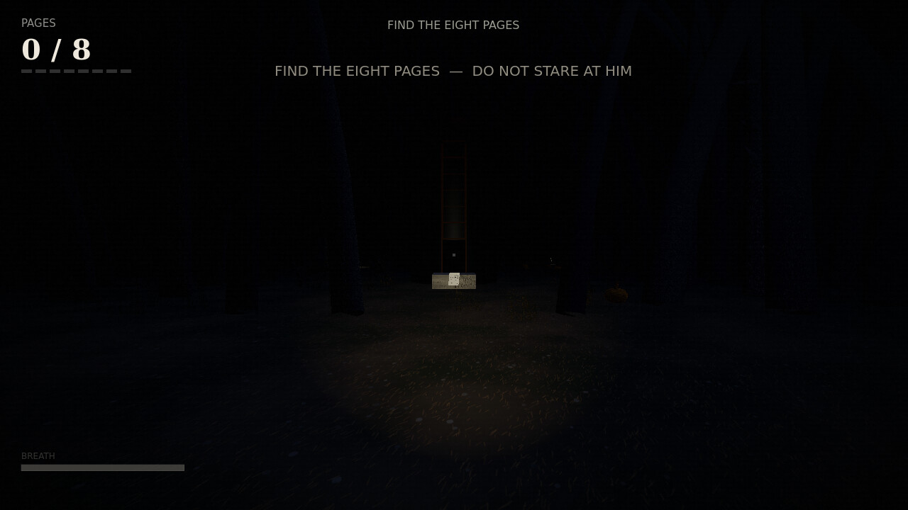 | 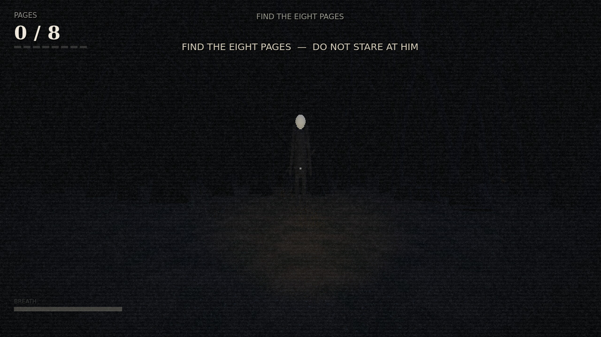 |
| 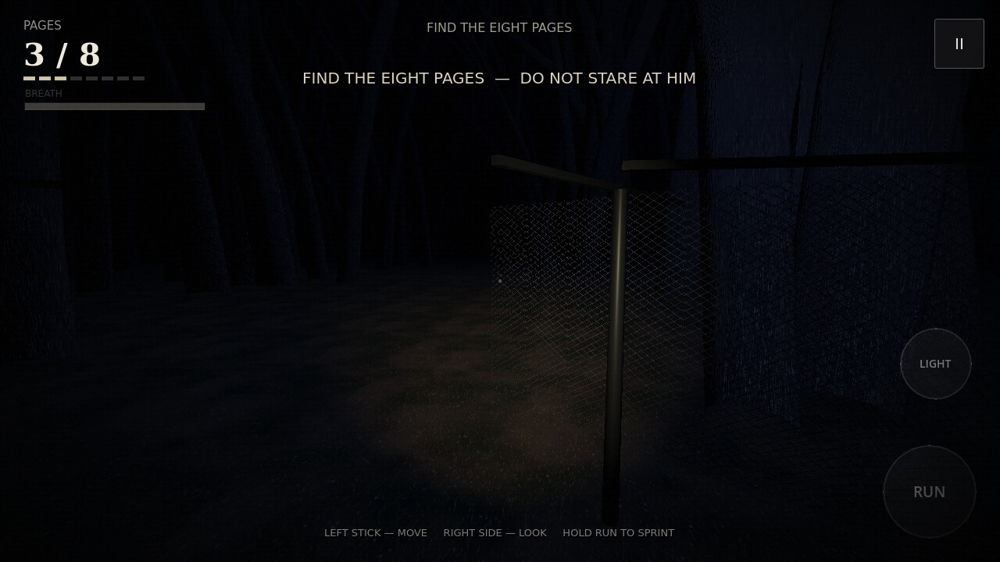 | 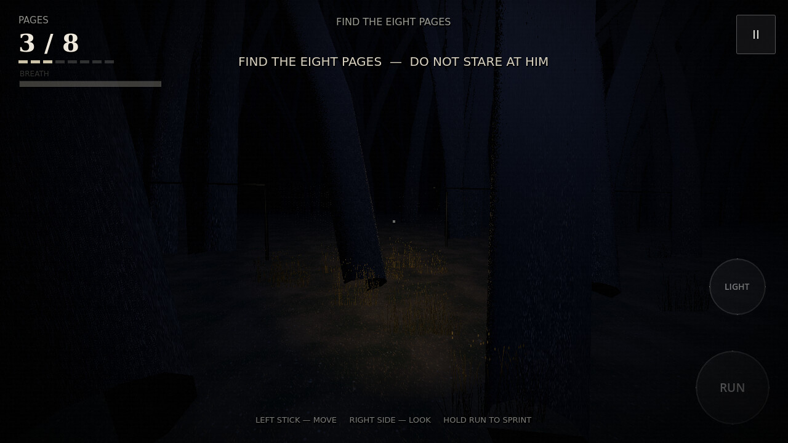 |
| 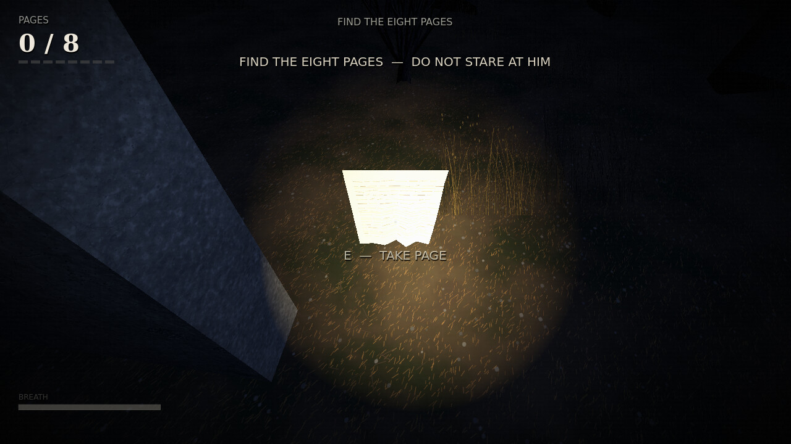 | 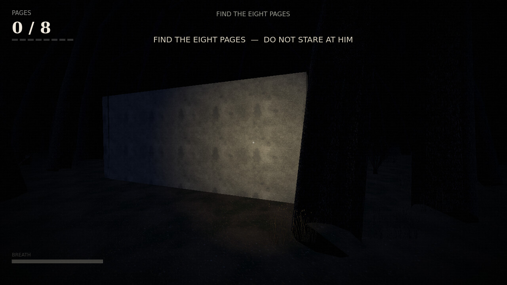 |
| 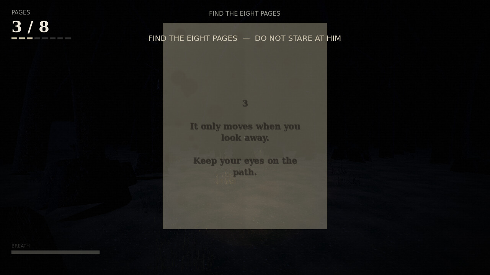 | 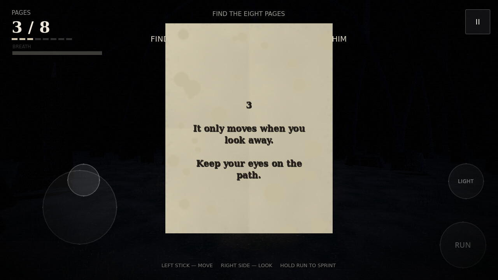 |
| 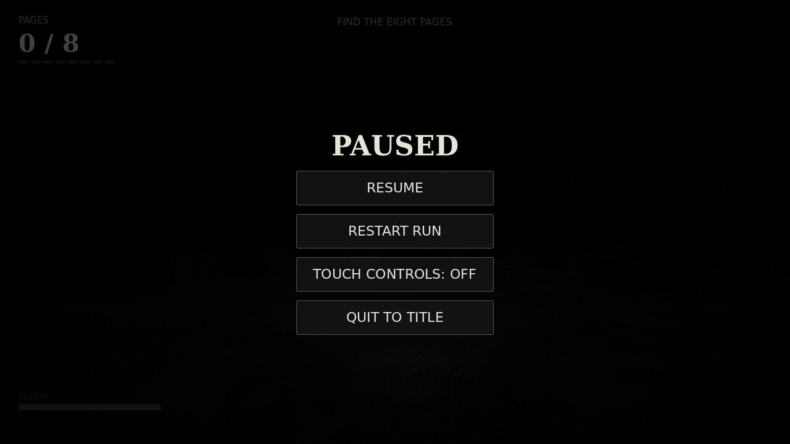 | 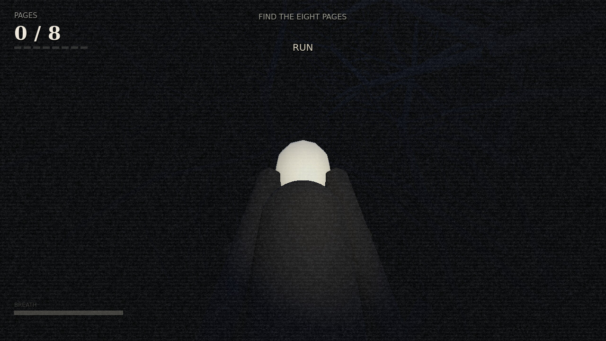 |
| 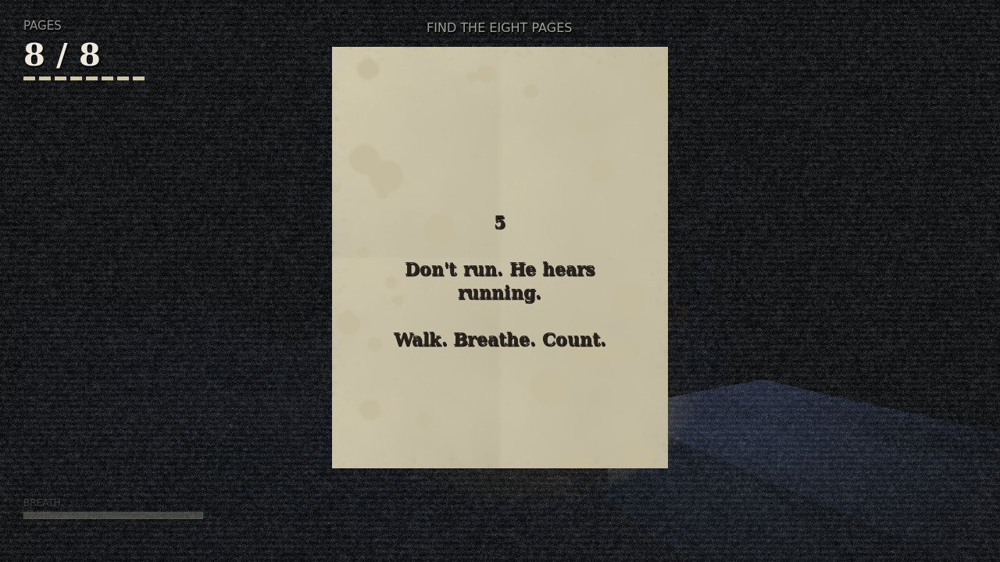 | 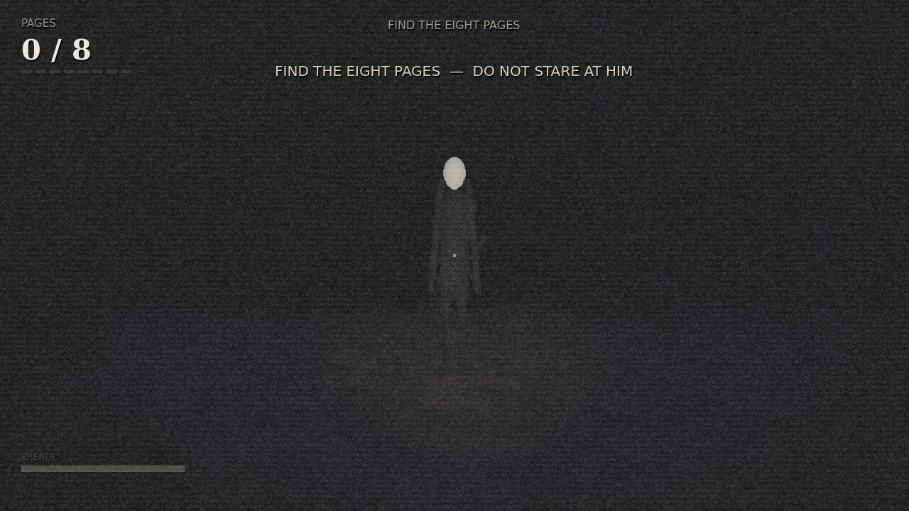 |

Portrait phone / web build: `screenshots/mobile_web_portrait.jpg`,
touch-UI tour at phone resolution: `screenshots/mobile/`,
Chromium captures of the exported web build: `screenshots/web/`.

---

## Licence / credits

Fan tribute, not affiliated with Parsec Productions. Original *Slender: The Eight
Pages* by Mark J. Hadley. All code and procedural assets here are original and
may be reused freely. Bundled DejaVu fonts are under the Bitstream Vera licence.
